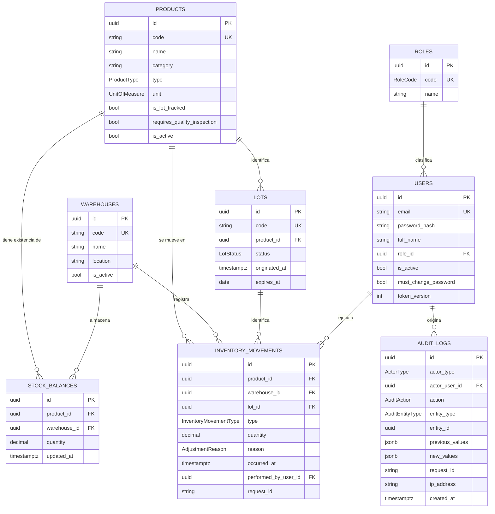
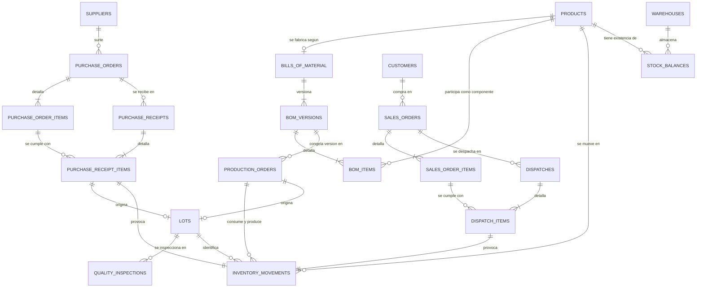

# Base de datos — EcoSoap ERP

> **Estado:** Foundation alineada con el cotejo de la Entrega 1 registrado en
> [`requirements.md`](requirements.md). La migración inicial corregida se verificó desde cero en
> PostgreSQL 18.6 el 2026-09-24; la prueba previa en PostgreSQL 16 corresponde a la revisión
> anterior de Foundation.

## 1. Alcance

### Estado físico y diseño de la siguiente ronda

`develop` en `f5fcc28` incluye A-1, C-1, Compras (PR #16) y A-2 (PR #15): ledger/saldos,
ajustes, BOM/versiones, OP DRAFT, recepciones y consultas conectadas. C-2 se implementa en
`feature/production-execution`; su modelo físico se describe al final de esta página.
`reason` sigue siendo obligatorio para ajustes mediante CHECK y nulo para movimientos
empresariales con FK. C-2 amplía el origen de lote Purchase a Purchase XOR Production.

El [diseño de Inventario, Compras y Producción](specs/2026-10-10-inventory-purchases-production-design.md)
conserva los ADR 011–014 aceptados. El resto de esta página también describe el objetivo
conceptual; la ejecución/Calidad de C-2 todavía no se atribuye a `develop`, y Ventas sigue
pendiente. La existencia del diseño conceptual no acredita implementación de esos flujos.

Define el **modelo conceptual completo** de los cuatro dominios, aunque su implementación física
sea incremental. `InventoryMovement` es el punto donde convergen Compras, Producción y Ventas:
diseñarlo conociendo un solo dominio obligaría a rehacerlo al llegar el siguiente.

Decisiones que lo sostienen:

- [ADR 004 — Ledger de inventario y balance materializado](decisions/004-inventario-ledger-y-balance.md)
- [ADR 005 — Estrategia de auditoría](decisions/005-estrategia-de-auditoria.md)
- [ADR 006 — Estrategia de identificadores](decisions/006-estrategia-de-identificadores.md)
- [ADR 007 — Trazabilidad de lotes](decisions/007-trazabilidad-de-lotes.md)
- [ADR 008 — Sesión JWT en cookie con versión de sesión](decisions/008-sesion-jwt-en-cookie.md)
- [ADR 009 — Argon2id y contraseñas temporales](decisions/009-contrasenas-argon2id.md)

## 2. Convenciones

| Aspecto              | Convención                                                               |
| -------------------- | ------------------------------------------------------------------------ |
| Clave primaria       | `String @id @default(uuid(7)) @db.Uuid`                                  |
| Código humano        | Columna `code` o `number` aparte, única e indexada, nunca clave primaria |
| Nombres de tabla     | `snake_case` en plural mediante `@@map`                                  |
| Nombres de columna   | `snake_case` mediante `@map`                                             |
| Instantes            | `DateTime @db.Timestamptz(6)`, almacenados en UTC                        |
| Fechas de calendario | `DateTime @db.Date`, sin hora ni zona                                    |
| Cantidades           | `Decimal @db.Decimal(18, 4)`                                             |
| Precios unitarios    | `Decimal @db.Decimal(14, 4)`                                             |
| Importes             | `Decimal @db.Decimal(14, 2)`                                             |
| Borrado              | Lógico con `isActive`; nunca físico si hay histórico                     |
| Snapshots            | `Json @db.JsonB`                                                         |

**`snake_case`.** PostgreSQL pliega a minúsculas los identificadores sin comillas, de modo que
`SELECT * FROM InventoryMovement` falla. Como el equipo inspeccionará la base con `psql` y pgAdmin,
`snake_case` evita tener que entrecomillar en cada consulta.

### Instantes frente a fechas de calendario

No son el mismo tipo de dato y mezclarlos causa errores en el cambio de día.

| Campo                                            | Tipo          | Razón                                                                              |
| ------------------------------------------------ | ------------- | ---------------------------------------------------------------------------------- |
| `occurredAt`, `createdAt`, `updatedAt`           | `timestamptz` | Momentos exactos en la línea del tiempo                                            |
| `receivedAt`, `dispatchedAt`, `inspectedAt`      | `timestamptz` | Momentos exactos                                                                   |
| `startedAt`, `completedAt`, `originatedAt`       | `timestamptz` | Momentos exactos                                                                   |
| `ProductionOrder.plannedStartAt`, `plannedEndAt` | `timestamptz` | Opcionales, UTC; UI America/Managua. Decisión adoptada por C-1, sin `plannedDate`. |
| `PurchaseOrder.expectedDate`                     | `date`        | La fecha esperada de entrega es un día                                             |
| `Lot.expiresAt`                                  | `date`        | El vencimiento es un día, no una hora                                              |

### Zona horaria empresarial

Los instantes se guardan en UTC. Pero dos cosas necesitan una **zona empresarial explícita**
porque dependen del calendario local:

- El **año** usado por los códigos correlativos (`OC-2026-000001`).
- La interpretación de las fechas de calendario introducidas por el usuario.

La zona empresarial es **`America/Managua`** (UTC−6, sin horario de verano). Sin fijarla, dos
usuarios operando cerca de medianoche del 31 de diciembre obtendrían años distintos.

### Redondeo monetario

`lineTotal = round(quantity × unitPrice, 2)`. Los totales del documento suman importes de línea ya
redondeados, de modo que lo mostrado y lo almacenado coinciden. Una sola moneda; no hay tabla de
divisas.

## 3. Enums

### Fundación

```text
RoleCode              ADMIN · COMPRAS · INVENTARIO · PRODUCCION · VENTAS
ProductType           RAW_MATERIAL · INTERMEDIATE · FINISHED_GOOD · CONSUMABLE
UnitOfMeasure         UNIT · GRAM · KILOGRAM · MILLILITER · LITER
LotStatus             QUARANTINED · RELEASED · REJECTED
InventoryMovementType ADJUSTMENT_IN · ADJUSTMENT_OUT · PURCHASE_RECEIPT
                      PRODUCTION_CONSUMPTION · PRODUCTION_OUTPUT · SALE_DISPATCH
AdjustmentReason      INITIAL_LOAD · PHYSICAL_COUNT · DAMAGE · LOSS · EXPIRY · CORRECTION
ActorType             USER · SYSTEM · ANONYMOUS
AuditAction           CREATE · UPDATE · DELETE · ENABLE · DISABLE
                      LOGIN · LOGIN_FAILED · LOGOUT · ADJUST_STOCK
                      CHANGE_ROLE · CHANGE_PASSWORD · RESET_PASSWORD   (migración auth_rbac)
                      CONFIRM · CANCEL · DISPATCH                        (Ventas)
AuditEntityType       USER · ROLE · PRODUCT · WAREHOUSE · LOT · INVENTORY_MOVEMENT
DocumentType          LOT
```

`AdjustmentReason` no incluye `OTHER`: un motivo genérico vacía de sentido la obligación de dar un
motivo. Si aparece un caso real que no encaje, se amplía el enum.

Aprobar y rechazar calidad tendrán acciones propias (`QUALITY_APPROVE`, `QUALITY_REJECT`) en la
migración de Producción, en lugar de reutilizar `CONFIRM` y `CANCEL`.

### Por dominio — planificado, todavía no implementado

```text
PurchaseOrderStatus   DRAFT · CONFIRMED · PARTIALLY_RECEIVED · RECEIVED · CANCELLED
ProductionOrderStatus DRAFT · IN_PROGRESS · COMPLETED · CANCELLED
SalesOrderStatus      DRAFT · CONFIRMED · PARTIALLY_DISPATCHED · DISPATCHED · CANCELLED
QualityStatus         APPROVED · REJECTED
```

`AuditEntityType`, `AuditAction`, `InventoryMovementType` y `DocumentType` se amplían solo cuando la
migración de dominio incorpore las entidades o acciones correspondientes. Los códigos humanos de
los tipos futuros se documentan en §12, pero no son operables en Foundation.

## 4. Modelo de la fundación



`DocumentSequence` no aparece en el diagrama porque no tiene relaciones: es infraestructura
(`documentType`, `year`, `lastNumber`, único por `(documentType, year)`).

### Notas por entidad

**`User.mustChangePassword`** (migración `auth_rbac`) vale `true` por omisión: una cuenta creada por
un camino que no lo fije explícitamente queda obligada a cambiar la contraseña, que es el lado
seguro. El alta y el restablecimiento por ADMIN lo ponen en `true`; el cambio propio y el comando
`admin:create`, en `false`. Mientras es `true`, el backend solo permite `me`, `change-password` y
`logout` ([ADR 009](decisions/009-contrasenas-argon2id.md)).

**`User.tokenVersion`** (migración `auth_rbac`) es la versión de sesión que viaja en el JWT como
`ver`. Sube en logout, desactivación, cambio y restablecimiento de contraseña y cambio de rol; un
token con otra versión se rechaza ([ADR 008](decisions/008-sesion-jwt-en-cookie.md)). No se audita.

**`User.email`** se guarda normalizado, sin espacios exteriores y en minúsculas. Un `CHECK` de la
migración `auth_rbac` lo exige, de modo que el índice único existente garantiza la unicidad sin
distinguir mayúsculas.

**`Product.category`** es una clasificación funcional flexible, obligatoria y de hasta 100
caracteres (`VARCHAR(100)`). `Product.type` conserva el enum estructural `ProductType`: la Entrega 1
exige ambos atributos, pero no proporciona un catálogo cerrado de categorías. No se introduce un
enum ni una entidad de categorías en Foundation.

**`Warehouse.location`** es texto obligatorio de hasta 255 caracteres (`VARCHAR(255)`). Representa
la ubicación descriptiva requerida por la Entrega 1, sin coordenadas ni dirección estructurada.

**`Product`** gana `requiresQualityInspection`. Decide si sus lotes nacen en cuarentena. Sin esta
bandera habría que elegir entre obligar a inspeccionar cada recepción de materia prima o no poder
bloquear nunca un lote.

**`Lot.originatedAt`** sustituye a `producedAt`. Es el instante en que el lote pasó a existir:
la finalización de la producción o la recepción de la mercancía. Un campo llamado «producido» que
además significara «recibido» haría ambiguas todas las consultas.

**`InventoryMovement.reason`** es obligatorio en A-1: los únicos movimientos instalados son ajustes,
y cada ajuste requiere un motivo tipificado tanto en la validación de la API como en la regla de
base de datos. Compras añadirá posteriormente los movimientos empresariales que admitan `reason`
nulo, junto con su FK de origen y la regla de integridad correspondiente. Una nota libre no basta
como justificación: un motivo tipificado se puede filtrar, contar y auditar.

## 5. Matriz tipo → origen por migración

Este es el punto que la auditoría marcó como P0. Un movimiento no puede apuntar por clave foránea
a una tabla que todavía no existe, y tampoco se admite `sourceType + sourceId` sin clave foránea,
porque renunciaría a la integridad referencial.

La solución es que **cada migración declare qué tipos acepta y cuál es su origen obligatorio**, y
reemplace la restricción `CHECK` anterior por la ampliada.

| Migración                    | Tipos permitidos                                 | Origen obligatorio                     | Columna añadida            |
| ---------------------------- | ------------------------------------------------ | -------------------------------------- | -------------------------- |
| Foundation (actual)          | `ADJUSTMENT_IN`, `ADJUSTMENT_OUT`                | ninguno; `reason` requerido en ajustes | —                          |
| Compras (planificada)        | \+ `PURCHASE_RECEIPT`                            | `purchaseReceiptItemId`; `reason` nulo | `purchase_receipt_item_id` |
| Producción C-2 (planificada) | \+ `PRODUCTION_CONSUMPTION`, `PRODUCTION_OUTPUT` | `productionOrderId`                    | `production_order_id`      |
| Ventas RF-VEN-003            | \+ `SALE_DISPATCH`                               | `saleDispatchItemId`; `reason` nulo    | `sale_dispatch_item_id`    |

La restricción de la fundación es, literalmente:

```sql
CHECK (
  type IN ('ADJUSTMENT_IN', 'ADJUSTMENT_OUT')
  AND reason IS NOT NULL
)
```

**La fundación no puede registrar recepciones, consumos ni despachos.** No es una limitación: es
la garantía de que ningún movimiento pueda existir sin un origen empresarial verificable. La
migración de Compras sustituye la restricción por:

```sql
CHECK (
  (type IN ('ADJUSTMENT_IN','ADJUSTMENT_OUT')
     AND reason IS NOT NULL
     AND purchase_receipt_item_id IS NULL)
  OR
  (type = 'PURCHASE_RECEIPT'
     AND reason IS NULL
     AND purchase_receipt_item_id IS NOT NULL)
)
```

y así sucesivamente. Cada migración amplía tanto el enum como la restricción, y nunca deja un tipo
habilitado cuyo origen no pueda comprobarse.

Cada tipo empresarial admite únicamente su FK de origen; las demás son nulas. La recepción
genera un movimiento positivo por línea, con unicidad de `purchaseReceiptItemId` en el movimiento.
Inventario convierte la magnitud positiva del comando al signo persistido del tipo.
El origen genérico del contrato interno siempre se representa mediante FKs físicas concretas.

## 6. Invariantes de integridad

### Producto del lote y del movimiento

`InventoryMovement.productId` debe coincidir con `Lot.productId` cuando hay lote. Esto **no** se
deja a la validación de backend: se garantiza con una **clave foránea compuesta**, verificada como
viable en Prisma 7.

```prisma
model Lot {
  id        String @id @default(uuid(7)) @db.Uuid
  productId String @map("product_id") @db.Uuid
  @@unique([id, productId])      // habilita la referencia compuesta
}

model InventoryMovement {
  productId String  @map("product_id") @db.Uuid
  lotId     String? @map("lot_id") @db.Uuid
  lot       Lot?    @relation(fields: [lotId, productId], references: [id, productId])
}
```

PostgreSQL rechaza entonces cualquier movimiento cuyo lote pertenezca a otro producto. La misma
técnica se aplica en las migraciones siguientes a `PurchaseReceiptItem` ↔ `PurchaseOrderItem` y a
`DispatchItem` ↔ `SalesOrderItem`, para que la línea cumplida y la ordenada no puedan referirse a
productos distintos.

### Coherencia con `isLotTracked`

- Si `Product.isLotTracked` es verdadero, todo movimiento de ese producto debe llevar `lotId`.
- Si es falso, `lotId` debe ser nulo.

Una restricción `CHECK` **no puede consultar otra tabla**, de modo que esta regla vive en el
servicio de inventario y en sus pruebas. Es una limitación real de PostgreSQL, no una elección.

### Cambio de `isLotTracked`

**Actual:** `Product.isLotTracked` existe en Foundation, pero los DTO y el servicio de Productos
no exponen su edición. No existe todavía un flujo de configuración ni una guarda de historial
para editar esta bandera; el bloqueo actual de unidad/tipo no demuestra esa funcionalidad.

**Planificado para A-2:** si el producto tiene **cualquier `InventoryMovement`**, se rechaza
cambiar `isLotTracked`, aunque su saldo sea cero. La validación se serializará con las escrituras
de inventario para que un movimiento concurrente no pueda eludirla. Sin historial podrá cambiarse
mediante el flujo autorizado y auditado de configuración.

La descripción anterior sugería vaciar el saldo mediante ajustes, cambiar la bandera y recargar.
Los ajustes no borran el ledger: saldo cero no elimina historial ni habilita el cambio en esta
ronda. Ese procedimiento histórico del ADR 007 no está implementado ni se habilita aquí;
se conserva el ADR original sin modificarlo.

### Origen único del lote

| Tipo de lote           | Origen                | Se añade en             |
| ---------------------- | --------------------- | ----------------------- |
| Materia prima          | `PurchaseReceiptItem` | Migración de Compras    |
| Intermedio y terminado | `ProductionOrder`     | Migración de Producción |

Desde la migración de Compras, un `CHECK` de arco exclusivo exige que todo lote tenga exactamente un
origen. **No deben existir lotes trazables operativos sin origen empresarial identificable.** En A-1
no hay endpoint ni flujo de negocio para crear lotes; `applyMovements` solo acepta un lote existente
y falla si el identificador no existe. Si la fila existente carece de origen empresarial, A-1 no
puede detectarlo y el contrato interno puede registrar movimientos contra ella. Las pruebas crean
lotes directamente como fixtures; A-1 no tiene operación de negocio ni endpoint para crearlos. La
FK y la validación de origen se incorporarán con Compras y Producción; hasta entonces, Foundation
no puede garantizar el rechazo de una fila existente sin origen. El DoD de A-1 es no crear lotes
automáticamente ni ofrecer alta operativa; el rechazo por origen pertenece a Compras.

El ADR 013 aceptado concreta ese origen en `Lot.purchaseReceiptItemId` o
`Lot.productionOrderId`, con FK y unicidad de cada origen. Compras habilita únicamente el
primero; C-2 amplía a XOR preservando los datos recibidos. Inventario crea los lotes dentro
del plan de recursos/transacción del llamador. A-1 no ofrece esa creación operativa; la validación
del origen comienza con las FKs de Compras.

Consecuencia que conviene tener presente: **durante A-1 no debe crearse ningún lote operativo**,
porque todavía no existe ningún documento que pueda originarlo. Los fixtures de prueba pueden crear
lotes directamente para verificar reglas del ledger, pero esa vía no está expuesta como operación
empresarial. La carga inicial operativa de inventario con lotes se hará cuando exista Compras.

## 7. Política de calidad y liberación de lotes

Los estados y la bandera de Producto existen en Foundation; `QualityInspection` y su flujo
todavía no existen. El alcance mínimo propuesto de C-2 inspecciona lotes producidos; extenderlo
a lotes recibidos queda por acordar y no es una obligación arquitectónica de los ADR aprobados.
La ausencia de inspección implica cuarentena solo cuando el producto la requiere. Un lote de
Compra que la requiera permanece bloqueado hasta disponer del flujo autorizado, sin liberación
automática por estar fuera del alcance mínimo.

> La Entrega 1 exige controles de calidad por lote, incluyendo resultado y no conformidades, pero
> no prescribe esta política de liberación. Los estados exactos, `requiresQualityInspection` y el
> bloqueo de consumo/despacho se conservan como decisiones `PROPUESTO` en
> [`requirements.md`](requirements.md) (`P-PRO-002` a `P-PRO-004`), no como requisitos oficiales.

```text
Lote creado
    ↓
requiresQualityInspection = false  →  RELEASED
requiresQualityInspection = true   →  QUARANTINED
                                          ↓
                                   QualityInspection
                                    ↓            ↓
                              APPROVED      REJECTED
                                    ↓            ↓
                               RELEASED      REJECTED
```

| Estado        | Despacho  | Consumo en producción | Ajuste de salida |
| ------------- | --------- | --------------------- | ---------------- |
| `QUARANTINED` | Bloqueado | Bloqueado             | Permitido        |
| `RELEASED`    | Permitido | Permitido             | Permitido        |
| `REJECTED`    | Bloqueado | Bloqueado             | Permitido        |

**El consumo también se bloquea, no solo el despacho.** La auditoría preguntaba expresamente si
debía hacerse. Debe: fabricar jabón con aceite rechazado contamina un lote de producto terminado
que después habría que retirar del mercado. Bloquear únicamente el despacho protege al cliente
pero no al proceso, que es donde el daño se multiplica.

El ajuste de salida permanece permitido en todos los estados porque es precisamente la vía para
dar de baja material rechazado.

Un lote puede tener varias inspecciones si se permite reinspección. **El estado vigente del lote
es `Lot.status`**, no el resultado de la última inspección: en el flujo planificado Calidad
registrará la inspección y solicitará a Inventario la transición dentro de la misma transacción.
Así no habrá dos fuentes de verdad; la reinspección permanece por definir.

## 8. Protocolo transaccional de inventario

El protocolo **actual de ajustes Foundation** es:

```text
BEGIN
  1. bloquear producto y luego almacén (FOR SHARE); validar operación y estados
  2. obtener o crear la fila de StockBalance del par (producto, almacén)
  3. bloquear esa fila            SELECT ... FOR UPDATE
  4. validar la existencia general
  5. validar la existencia y el estado del lote, cuando aplique
  6. crear InventoryMovement
  7. actualizar StockBalance
  8. actualizar el documento empresarial
  9. crear AuditLog
COMMIT
```

`applyAdjustment` toma `FOR SHARE` sobre producto y almacén antes de leer sus
estados. Estos bloqueos se mantienen hasta terminar la transacción y compiten
con el `FOR NO KEY UPDATE` de las ediciones y desactivaciones del catálogo.
Después de una espera se leen los valores vigentes: un catálogo desactivado
rechaza el ajuste, y un ajuste confirmado bloquea la desactivación con saldo
o el cambio de unidad/tipo con historial. Dos ajustes pueden compartir estos
bloqueos; el saldo sigue serializándose con `FOR UPDATE`.

### Creación de la primera fila

El paso 2 tiene una condición de carrera propia: dos operaciones simultáneas sobre un producto sin
balance previo intentarían insertar la misma fila. Se resuelve con
`INSERT ... ON CONFLICT (product_id, warehouse_id) DO NOTHING`, mediante
`createMany(skipDuplicates)`, seguido del `SELECT ... FOR UPDATE`.
Nunca con «comprobar si existe y luego insertar», que es exactamente la carrera que se quiere
evitar. La prueba concurrente de Foundation verifica esta ruta.

### Orden estable de bloqueo

Una operación que toca varios productos —completar una producción consume varios componentes—
debe bloquear sus filas **en un orden determinista** para no provocar interbloqueos.

El orden es: **ascendente por `product_id`, y a igualdad, por `warehouse_id`**. Dos operaciones
concurrentes que compitan por los mismos productos los tomarán en la misma secuencia, de modo que
una espera a la otra en lugar de bloquearse mutuamente.

### Disponibilidad por lote

Se calcula sumando los movimientos del lote **dentro del mismo bloqueo** del paso 3. Como todos
los movimientos del par `(producto, almacén)` se serializan sobre esa fila, el resultado es
consistente sin necesidad de una tabla `LotBalance`.

### Ampliación global aceptada, pendiente de implementación en A-1, Compras y C-2

El ADR 012 establece una transacción del caso de uso llamador y este orden de grupos:
documento empresarial → `document_sequences` → `products` → `warehouses` →
`stock_balances` → `lots`. Dentro de cada grupo se usa un orden estable: documentos por tipo/ID,
catálogos/lotes por ID, contadores por `(documentType, year)` y balances por
`(productId, warehouseId)`, preservando el ADR 004.

Se recopilan previamente todos los productos, almacenes, saldos, lotes y números necesarios.
Las secuencias de recepción y lotes se reservan juntas antes de productos. Inventario recibe
todas las líneas y crea los lotes con origen después de adquirir los recursos; crear un lote
aislado antes de bloquear los componentes completos puede invertir el orden.
Calidad coordina saldos y lote con ese mismo protocolo. Las validaciones se repiten después
de esperar, y documentos/movimientos/saldos/lotes/auditoría se confirman o revierten juntos.
La implementación y la prueba de este protocolo global todavía están pendientes.

## 9. Reconciliación

La invariante del sistema debe poder comprobarse en cualquier momento:

```sql
SELECT sb.product_id,
       sb.warehouse_id,
       sb.quantity                      AS balance,
       COALESCE(SUM(im.quantity), 0)    AS ledger,
       sb.quantity - COALESCE(SUM(im.quantity), 0) AS diferencia
FROM stock_balances sb
LEFT JOIN inventory_movements im
       ON im.product_id  = sb.product_id
      AND im.warehouse_id = sb.warehouse_id
GROUP BY sb.product_id, sb.warehouse_id, sb.quantity
HAVING sb.quantity <> COALESCE(SUM(im.quantity), 0);
```

Un resultado vacío significa que balance y ledger concuerdan. La consulta forma parte de las
pruebas de integridad. **No se implementa todavía como tarea automática**: la ejecuta el equipo y
la ejecutan las pruebas.

## 10. Modelo conceptual completo

Propuesta de la siguiente ronda: proveedores/clientes y Foundation ya existen; los documentos
transaccionales, BOM/versiones, OP e inspecciones de este diagrama todavía no están implementados.



### Compras — migración `purchases`

| Entidad               | Papel       | Campos relevantes                                                                                                                      |
| --------------------- | ----------- | -------------------------------------------------------------------------------------------------------------------------------------- |
| `Supplier`            | Raíz        | `code` UK, `name`, `taxId?`, `email?`, `phone?`, `address?`, `isActive`                                                                |
| `PurchaseOrder`       | Raíz        | `number` UK, `supplierId`, `status`, `orderedAt`, `expectedDate?` (date), `createdByUserId`                                            |
| `PurchaseOrderItem`   | Dependiente | `purchaseOrderId`, `productId`, `quantityOrdered`, `unitPrice`, `lineTotal`                                                            |
| `PurchaseReceipt`     | Raíz        | `number` UK, `purchaseOrderId`, `receivedAt`, `receivedByUserId`, `notes?`                                                             |
| `PurchaseReceiptItem` | Dependiente | `purchaseReceiptId`, `purchaseOrderItemId`, `productId`, `warehouseId`, `quantity`; lote por relación inversa desde su origen en `Lot` |

**`quantityReceived` no se almacena.** Es la suma de las líneas de recepción de esa línea de
orden, y almacenarla crearía un tercer dato derivado que puede desincronizarse. Se deriva; si el
rendimiento algún día lo exigiera, materializarla requeriría las mismas garantías transaccionales
que `StockBalance` y quedaría registrado en un ADR.

Una línea de recepción representa una combinación concreta de producto, almacén y, cuando aplica,
lote. Repartir una entrega entre dos lotes exige dos líneas y produce dos movimientos.

Se conserva una sola identidad de origen del lote desde `Lot.purchaseReceiptItemId`, sin
otro `PurchaseReceiptItem.lotId` editable. Estados de compra previstos: `DRAFT`, `CONFIRMED`,
`PARTIALLY_RECEIVED`, `RECEIVED`, `CANCELLED`. Confirmar no modifica stock; solo la recepción
crea entradas. El bloqueo de la OC serializa recepciones y evita exceder la cantidad ordenada.

### Producción — migraciones planificadas C-1 y C-2

| Entidad             | Papel       | Campos relevantes                                                                                                                                                                             |
| ------------------- | ----------- | --------------------------------------------------------------------------------------------------------------------------------------------------------------------------------------------- |
| `BillOfMaterial`    | Raíz        | `productId` único, `name`, `isActive`; fórmula de un producto manufacturable                                                                                                                  |
| `BomVersion`        | Dependiente | `bomId`, `version`, `outputQuantity`, `isActive`, `createdByUserId`; único `(bomId, version)`                                                                                                 |
| `BomItem`           | Dependiente | `bomVersionId`, `componentProductId`, `quantity`; componente único por versión                                                                                                                |
| `ProductionOrder`   | Raíz        | `number` UK, `productId`, `bomVersionId`, `warehouseId`, `quantityPlanned`, `quantityProduced`, `status`, `plannedStartAt?`, `plannedEndAt?`, `startedAt?`, `completedAt?`, `createdByUserId` |
| `QualityInspection` | Raíz        | `lotId`, `status` (`APPROVED`/`REJECTED`), `observations?`, `nonconformities?`, `inspectedAt`, `inspectedByUserId`                                                                            |

**`BomItem` no tiene columna de unidad.** La cantidad se expresa en la unidad base del componente,
que ya está en `Product.unit`. Una unidad propia implicaría conversiones que el proyecto declara
inexistentes, y una conversión implícita y no implementada es peor que ninguna.

**Planificación adoptada por C-1:** `plannedStartAt` y `plannedEndAt` opcionales como
instantes `timestamptz`/UTC, interpretados por la UI en `America/Managua`.
Cualquiera puede omitirse; si existen ambos, el fin debe ser igual o posterior al inicio.
Solo se editan en `DRAFT`, no representan inicio/finalización reales y no se agrega `plannedDate`.
P-PRO-005 conserva origen `PROPUESTO`: es una decisión del equipo, no un nuevo requisito oficial.

En `feature/production-core`, las migraciones `20261010180000_production_boms` y
`20261010220000_production_orders` materializan BOM/versiones/componentes y OP.
La segunda añade `DocumentType.OP`, `AuditEntityType.PRODUCTION_ORDER` y
`AuditAction.CANCEL_PRODUCTION`; checks protegen cantidad planificada positiva,
producida no negativa y ventana de planificación. C-1 mantiene producción real en cero.
Las migraciones compartidas anteriores permanecen intactas. Calidad y ejecución siguen en C-2.

**Congelación de la versión de BOM.** `ProductionOrder.bomVersionId` apunta a la versión exacta
usada. Una `BomVersion` referenciada por alguna orden **no puede modificarse**: las correcciones
crean una versión nueva. Solo una versión está activa por fórmula; activación y uso se serializan.
La inmutabilidad protege contenido/cantidad base/componentes; activar o desactivar para nuevas
OP conserva ese contenido y las referencias históricas.
La regla debe implementarse y probarse en el backend porque exige consultar otra
tabla. Es la extensión `P-PRO-001`, aceptada como decisión en ADR 014, no una exigencia académica literal.
Sin ella, editar una fórmula reescribiría la historia de lo que realmente se fabricó.

Estados de OP aceptados en ADR 014: `DRAFT`, `IN_PROGRESS`, `COMPLETED`, `CANCELLED`, sin `CONFIRMED`.
El producto fabricado exige `isLotTracked = true`. Una OP usa un almacén para consumo y output.
START valida disponibilidad sin consumir/reservar; COMPLETE consume según `quantityPlanned`
y produce `quantityProduced`, con `0 < quantityProduced <= quantityPlanned`, dentro de una
transacción con un único lote de output y auditoría. Calidad registrará `APPROVED`/`REJECTED`;
cuando se requiera inspección, la espera se representa con lote `QUARANTINED`. Sin ese requisito
el lote nace `RELEASED`. Son decisiones aceptadas en ADR 014, todavía sin schema físico de Producción.

### Ventas — migración `sales`

| Entidad          | Papel       | Campos relevantes                                                                  |
| ---------------- | ----------- | ---------------------------------------------------------------------------------- |
| `Customer`       | Raíz        | `code` UK, `name`, `taxId?`, `email?`, `phone?`, `address?`, `isActive`            |
| `SalesOrder`     | Raíz        | `number` UK, `customerId`, `status`, `orderedAt`, `createdByUserId`                |
| `SalesOrderItem` | Dependiente | `salesOrderId`, `productId`, `quantityOrdered`, `unitPrice`, `lineTotal`           |
| `Dispatch`       | Raíz        | `number` UK, `salesOrderId`, `dispatchedAt`, `dispatchedByUserId`, `notes?`        |
| `DispatchItem`   | Dependiente | `dispatchId`, `salesOrderItemId`, `productId`, `warehouseId`, `lotId?`, `quantity` |

`quantityDispatched` tampoco se almacena, por la misma razón que `quantityReceived`.

### Confirmar una venta no reserva inventario

En esta versión **no existen reservas**. La consecuencia debe quedar explícita porque afecta a lo
que `CONFIRMED` significa:

```text
CONFIRM SALES ORDER
  → comprueba disponibilidad de forma INFORMATIVA
  → no bloquea, no reserva, no garantiza nada

DISPATCH
  → vuelve a comprobar
  → bloquea StockBalance
  → valida el lote y su estado
  → genera el movimiento
```

La disponibilidad solo queda determinada al despachar. Una orden confirmada puede quedarse sin
existencia si otra operación la consume antes. Implementar reservas sería un requisito nuevo.

## 11. Integridad

### Unicidad

```text
roles.code · users.email · products.code · warehouses.code · lots.code
suppliers.code · customers.code
purchase_orders.number · purchase_receipts.number
production_orders.number · sales_orders.number · dispatches.number
stock_balances (product_id, warehouse_id)
bills_of_material (product_id) -- planificado
bom_versions (bom_id, version) -- planificado
bom_items (bom_version_id, component_product_id) -- planificado
document_sequences (document_type, year)
lots (id, product_id)          -- habilita la clave foránea compuesta
```

### Restricciones `CHECK`

Prisma no modela `CHECK`; se añaden como SQL dentro de la migración correspondiente.

| Tabla                  | Restricción                                                                                    |
| ---------------------- | ---------------------------------------------------------------------------------------------- |
| `stock_balances`       | `quantity >= 0`                                                                                |
| `inventory_movements`  | `quantity <> 0`                                                                                |
| `inventory_movements`  | el signo de `quantity` concuerda con `type`                                                    |
| `inventory_movements`  | matriz tipo → origen de la migración vigente (§5)                                              |
| `audit_logs`           | `entity_type` y `entity_id` nulos o presentes a la vez                                         |
| `audit_logs`           | solo `LOGIN_FAILED` puede omitir la entidad                                                    |
| `audit_logs`           | `actor_type = USER` exige `actor_user_id`; `SYSTEM` y `ANONYMOUS` lo prohíben                  |
| `audit_logs`           | `LOGIN_FAILED` siempre anónimo; `LOGIN` identifica al usuario autenticado como actor y entidad |
| `users`                | `email = lower(btrim(email))` (migración `auth_rbac`)                                          |
| `users`                | `token_version >= 0` (migración `auth_rbac`)                                                   |
| `lots`                 | desde la migración de Compras: exactamente un origen empresarial                               |
| `purchase_order_items` | `quantity_ordered > 0`                                                                         |
| `sales_order_items`    | `quantity_ordered > 0`                                                                         |
| `bom_items`            | `quantity > 0`                                                                                 |
| `production_orders`    | `quantity_planned > 0`                                                                         |

### Reglas que `CHECK` no puede expresar

Una restricción `CHECK` no puede consultar otra tabla. La capa de servicios
debe garantizar las reglas que dependen de otras entidades:

- Coherencia entre `Product.isLotTracked` y la presencia de `lotId`.
- Bloqueo de consumo y despacho según `Lot.status`.
- Prohibición de cambiar `isLotTracked` con cualquier movimiento existente, incluso con saldo
  cero (planificada para A-2; aún sin flujo de edición).
- Prohibición de cambiar `Product.unit` o `Product.type` cuando el producto
  tenga algún `InventoryMovement`, aunque sus saldos actuales sean cero.
- Prohibición de desactivar un producto si tiene algún `StockBalance.quantity`
  distinto de cero en cualquiera de sus almacenes.
- Prohibición de desactivar un almacén si tiene algún `StockBalance.quantity`
  distinto de cero para cualquiera de sus productos.
- Inmutabilidad de una `BomVersion` ya usada por una orden (planificada).
- Tope de cantidad recibida o despachada frente a la ordenada.

En `feature/products-warehouses`, las restricciones de unidad, tipo y
desactivación están implementadas en `ProductsService` y `WarehousesService`.
Se comprueban dentro de la transacción, después de bloquear la fila del
catálogo y antes de modificarla.

Si alguna de estas restricciones impide la operación, la API devuelve `409`,
conserva los valores del recurso y no registra un evento `UPDATE` o `DISABLE`
para la operación rechazada.

Para desactivar se exige saldo cero en cada balance asociado; no basta con
comprobar un único almacén o producto. Se permite desactivar cuando no hay
balances o cuando todos están en cero, aunque existan movimientos históricos.
La reactivación no exige saldo cero. Estas operaciones no alteran saldos ni
crean movimientos.

Las pruebas de estas reglas de catálogo están en
`backend/test/products-history.e2e-spec.ts` y
`backend/test/catalog-stock-rules.e2e-spec.ts`. La coordinación con ajustes,
en ambos órdenes de confirmación, se prueba en
`backend/test/catalog-adjustments-concurrency.e2e-spec.ts`.

Las reglas de BOM se implementan en C-1 mediante checks, índice parcial de versión activa,
triggers de inmutabilidad y validación transaccional. Recepción y despacho siguen en sus entregas.

### Disparadores

`inventory_movements` y `audit_logs` rechazan `UPDATE` y `DELETE`. Además, la cuenta de aplicación
no debe tener permiso de `TRUNCATE` sobre ellas.

> **Probado en PostgreSQL 16 temporal y 18.6 del proyecto:** la migración se aplicó desde cero;
> una segunda ejecución de `migrate dev` no reportó drift, y las pruebas rechazaron cambios al
> ledger y a auditoría. Véase la evidencia en [`progress.md`](progress.md).

### Borrado

Todas las claves foráneas usan `onDelete: Restrict`. Los datos maestros se desactivan con
`isActive`; los usuarios referenciados por movimientos, documentos y auditoría sobreviven siempre
a su desactivación.

### Índices

```text
products (type) · products (is_active)
lots (product_id) · lots (status)
inventory_movements (product_id, occurred_at)
inventory_movements (lot_id, warehouse_id)
inventory_movements (warehouse_id, occurred_at)
inventory_movements (request_id)
audit_logs (entity_type, entity_id, created_at)
audit_logs (actor_user_id, created_at)
audit_logs (created_at) · audit_logs (request_id)
purchase_orders (supplier_id, status) · sales_orders (customer_id, status)
production_orders (status) · production_orders (planned_date)
```

Las columnas `code` y `number` obtienen su índice de la restricción de unicidad. Se añadirán
índices compuestos adicionales cuando existan consultas concretas que los justifiquen, no antes.

## 12. Numeración de documentos

`DocumentSequence` mantiene un contador por `(documentType, year)`. El año se determina con la
**zona empresarial `America/Managua`**, no con UTC.

Formatos, en español para mantener coherencia con el idioma del proyecto:

```text
OC-2026-000001    orden de compra
REC-2026-000001   recepción
OP-2026-000001    orden de producción
OV-2026-000001    orden de venta
DES-2026-000001   despacho
LOT-2026-000001   lote
```

Reglas de la numeración:

- **Los huecos son válidos y esperados.** No se promete numeración consecutiva sin saltos.
- **Un número publicado o cancelado jamás se recicla.** Un documento cancelado conserva el suyo.
- El número se asigna dentro de la transacción que crea el documento, bloqueando la fila del
  contador.
- **El número no se muestra al usuario como definitivo hasta el commit.** Enseñar un número antes
  de confirmar induce a apuntarlo y luego no encontrarlo.

No se usan secuencias de PostgreSQL porque administrar una por cada combinación de tipo y año es
más engorroso que una tabla pequeña, y porque `nextval` tampoco evita los huecos.

## 13. Semilla inicial

### Bloqueos de administración y auditoría

`UsersService` aplica el protocolo del último ADMIN en READ COMMITTED: bloquea la fila objetivo,
valida estado y autoprotección y, solo cuando interviene el rol ADMIN, bloquea la fila de ese rol.
Antes de retirar un ADMIN activo cuenta los activos bajo el candado. Cambio y auditoría confirman
en la misma transacción; un fallo de auditoría revierte la operación.

Los dos bloqueos son `FOR NO KEY UPDATE`. El spec §9 originalmente decía `FOR UPDATE`, pero U9
detectó un interbloqueo al desactivarse dos administradores mutuamente: el `INSERT audit_logs`
necesita `FOR KEY SHARE` para comprobar la FK de su actor, incompatible con `FOR UPDATE`.
`FOR NO KEY UPDATE` permite esa comprobación y mantiene la exclusión entre escrituras; estas
operaciones no cambian claves. Se preservan orden objetivo → rol, candado condicional y nivel de
aislamiento. Véase spec §22 y evidencia en `progress.md`. Es una corrección del SQL de servicio,
sin editar migraciones compartidas ni el protocolo de inventario.

Repetible e idempotente, identificando las filas por su código estable:

- Los cinco roles: `ADMIN`, `COMPRAS`, `INVENTARIO`, `PRODUCCION`, `VENTAS`.
- Un almacén por defecto: `ALM-PRINCIPAL`, con ubicación inicial
  `Planta principal - Managua`. Es un valor descriptivo de desarrollo; puede sustituirse cuando se
  conozca una ubicación empresarial más precisa. Reejecutar el seed no sobrescribe esa ubicación.

**Sin usuario administrador.** El seed nunca crea credenciales. El primer administrador se crea con
el comando explícito `pnpm --filter backend admin:create`, que solo sirve como bootstrap: falla si
ya existe un ADMIN activo o el correo, nunca modifica un usuario existente y audita el alta como
`SYSTEM` ([ADR 009](decisions/009-contrasenas-argon2id.md)).

## 14. Plan de migraciones

| #         | Nombre                        | Contenido                                                                                                                                                                            |
| --------- | ----------------------------- | ------------------------------------------------------------------------------------------------------------------------------------------------------------------------------------ |
| 1         | `database_foundation`         | `Role`, `User`, `Product`, `Warehouse`, `Lot`, `StockBalance`, `InventoryMovement`, `AuditLog`, `DocumentSequence`, enums de fundación, `CHECK` de ajustes, disparadores append-only |
| 2         | `auth_rbac`                   | `users.token_version`, `users.must_change_password`, `CHECK` de correo normalizado, acciones `CHANGE_ROLE`, `CHANGE_PASSWORD` y `RESET_PASSWORD`                                     |
| 3         | `suppliers` (actual)          | Proveedores y `AuditEntityType.SUPPLIER`                                                                                                                                             |
| 4         | `customers` (actual)          | Clientes y `AuditEntityType.CUSTOMER`                                                                                                                                                |
| Posterior | `purchases` (planificada)     | Documentos de Compras; origen de lote recibido; `reason` nullable; enum y CHECK/FK de origen                                                                                         |
| Posterior | Producción C-1 (planificada)  | `BillOfMaterial`, `BomVersion`, `BomItem`, `ProductionOrder`; sin tipos de ejecución                                                                                                 |
| Posterior | Producción C-2 (planificada)  | Consumos/output con origen OP, lote producido y `QualityInspection`; preserva origen de Compras                                                                                      |
| Posterior | `sales` (fuera de esta ronda) | `SalesOrder`, `SalesOrderItem`, `Dispatch`, `DispatchItem`; reutiliza `Customer`                                                                                                     |

`suppliers` se introduce antes de `purchases`, con la tabla `suppliers` del modelo de §10 y el
valor `SUPPLIER` de `AuditEntityType`. Las órdenes, recepciones y el origen del lote de materia
prima siguen reservados para `purchases`.

`customers` se introduce antes de `sales`, con la tabla `customers` del modelo de §10 y el valor
`CUSTOMER` de `AuditEntityType`. Las órdenes de venta y los despachos siguen reservados para
`sales`. Esta migración es aditiva: conserva `suppliers`, los catálogos de Inventario, sus saldos,
movimientos y auditoría. El retorno a la versión anterior de la aplicación conserva la tabla,
el valor del enum y los datos de clientes; no requiere una eliminación de datos o de esquema.

`auth_rbac` se introdujo entre Foundation y Compras con la etapa de autenticación. El ADR 007, ya
aceptado, llama «migración 2» a la de Compras porque se redactó antes; ese texto designa la
migración `purchases`, no un número de orden.

Cada migración debe ser **autoconsistente**: sus restricciones deben ser válidas por sí solas y
no dejar relaciones huérfanas ni tipos habilitados sin origen verificable.

## 15. Riesgos

| Riesgo                                                           | Mitigación                                                                                  | Estado              |
| ---------------------------------------------------------------- | ------------------------------------------------------------------------------------------- | ------------------- |
| `StockBalance` desincronizado del ledger                         | Servicio único, disparadores, consulta de reconciliación en pruebas                         | Mitigado            |
| `CHECK` y disparadores frente a Prisma Migrate y base sombra     | Revisión anterior probada en PostgreSQL 16; migración actual desde cero y sin drift en 18.6 | **Probado en 18.6** |
| `ALTER TYPE ... ADD VALUE` en migraciones posteriores            | Probado en `auth_rbac`: tres valores en una migración, base limpia y actualización          | **Probado en 18.6** |
| Interbloqueos con varios productos                               | Orden estable de bloqueo por `product_id`, luego `warehouse_id` (§8)                        | Mitigado            |
| Carrera al crear la primera fila de balance                      | `INSERT ... ON CONFLICT DO NOTHING` seguido de `SELECT ... FOR UPDATE`                      | Mitigado            |
| `Decimal` operado como número de JavaScript                      | Regla explícita y prueba que la verifique                                                   | Mitigado            |
| Snapshots de auditoría con datos sensibles                       | Lista **permitida** de campos por entidad, no lista prohibida                               | Mitigado            |
| Un administrador de base puede alterar el disparador             | Aceptado: ninguna garantía de la aplicación protege frente a superusuario                   | Aceptado            |
| Cotejo con el documento académico oficial                        | Matriz OFICIAL/DERIVADO/PROPUESTO en `requirements.md`                                      | **Cerrado**         |
| `Product.category` y `Warehouse.location` exigidos por Entrega 1 | Columnas obligatorias en migración Foundation; seed y pruebas actualizados                  | **Cerrado**         |

## 16. Conexión local

```text
DATABASE_URL=postgresql://ecosoap:<password>@localhost:5433/ecosoap_erp?schema=public
```

El contenedor expone PostgreSQL en el puerto 5433 para no chocar con instalaciones nativas. Ver
[`setup.md`](setup.md), sección 4.

## Modelo físico de Compras (rama `feature/purchases`)

`PurchaseOrder` referencia proveedor/usuario y almacena número, estado, emisión y fecha esperada.
`PurchaseOrderItem` contiene producto, `quantityOrdered Decimal(18,4)`, `unitPrice Decimal(14,4)`
y `lineTotal Decimal(14,2)`. El CHECK verifica cantidad positiva, precio no negativo y
`lineTotal = round(quantityOrdered * unitPrice, 2)`. El total se deriva de las líneas.
`PurchaseReceipt` referencia OC/usuario con número, timestamp y notas; `PurchaseReceiptItem`
referencia línea de OC, producto, almacén y cantidad positiva. No existe `quantityReceived`
persistida; recibido y pendiente se calculan desde las recepciones.

La migración compartida `20261013031753_purchase_receipt` se conserva sin cambios.
`20261014010000_purchases_invariants` completa la habilitación de recepciones en una transacción:

- Sustituye el CHECK de ajustes por una matriz de signos, motivos y origen: ajustes con motivo
  y sin recepción; `PURCHASE_RECEIPT` positivo, sin motivo y con FK de recepción.
- Unicidad de `InventoryMovement.purchaseReceiptItemId` (a lo sumo una entrada por fila recibida).
- FK compuesta recepción → línea OC/producto; FK lote → recepción/producto; FK movimiento →
  recepción/producto/almacén/cantidad. Se conserva la FK lote/producto del ledger.
- `Lot.purchaseReceiptItemId` único y obligatorio mediante CHECK. No se duplica `lotId` en
  `PurchaseReceiptItem`; el lote se obtiene desde el origen.
- Índices para OC por estado/fecha y proveedor, líneas por OC, recepciones por OC/fecha y
  líneas recibidas por recepción/línea OC. Ledger y auditoría siguen append-only.

Antes de habilitar lotes operativos la migración detecta lotes sin origen y se detiene.
No elimina datos ni inventa recepciones para validarlos. Se requiere resolución explícita del
operador y reintento de la migración; no ejecutar un backfill automático. C-2 ampliará el CHECK
al XOR con Producción cuando exista ese origen; esta rama no lo implementa. Para rollback de
un despliegue que ya registró recepciones, no volver al binario A-1 ni borrar estas columnas:
el lector/escritor anterior no conoce los nuevos movimientos. Revertir el despliegue exige
una versión compatible o restauración explícita desde backup; no hay down migration destructiva.

La transacción del caso de uso bloquea OC → secuencias ordenadas → productos ordenados →
almacenes ordenados → balances `(productId, warehouseId)` → lotes existentes. Inventario
reserva los locks de catálogo antes de insertar líneas con FKs y reutiliza esos mismos locks
al aplicar entradas. Los flags del producto se releen después de esperar. Un cambio concurrente
de trazabilidad/calidad detectado entre planificación y lock exige reintentar; no solicita nuevas
secuencias después de bloquear catálogos. Compras no escribe lotes, movimientos ni saldos directamente.

## Modelo físico C-2 — ejecución y calidad

En `feature/production-execution`, dos migraciones nuevas preservan todas las compartidas
de la base `develop` al crear la rama. `20261014020000_production_execution_enums` incorpora
PRODUCTION_CONSUMPTION/PRODUCTION_OUTPUT, START/COMPLETE, QUALITY_APPROVE/QUALITY_REJECT,
QUALITY_INSPECTION y QualityResult. Sus enums se confirman antes de que la migración
`20261014021000_production_execution` los use en CHECKs.

- `Lot.purchaseReceiptItemId XOR Lot.productionOrderId` es un CHECK físico. Ambos orígenes
  son únicos; la FK compuesta lote–OP garantiza que el producto sea el de la orden.
- `InventoryMovement.productionOrderId` tiene FK compuesta OP/almacén e índice de consulta.
  No es globalmente único: una OP admite múltiples consumos. Un índice único parcial sobre OP
  WHERE type = PRODUCTION_OUTPUT admite como máximo un output. Un trigger de INSERT exige
  que el lote del output sea el originado por esa OP; se conserva la FK lote/producto.
- CHECK de movimiento conserva signos/motivos/FKs de ajustes y compras y añade consumo
  negativo/output positivo con OP, sin motivo ni origen de compra. Output exige lote.
- CHECK de OP limita producción real al plan y exige estados/fechas/cantidades coherentes:
  DRAFT/CANCELLED sin ejecución; IN_PROGRESS con inicio y producción cero; COMPLETED con
  cantidad positiva e inicio/fin no nulos, fin >= inicio.
- `QualityInspection` tiene `lotId` único, `result` APPROVED/REJECTED, `observations`
  obligatorias, `nonConformities` opcional y obligatorias en rechazo, `inspectedAt`, `createdAt`
  y responsable con FK a User.
  Una inspección por lote cierra el alcance sin habilitar reinspección.

Los lotes de Compras, sus FKs, movimientos y saldos permanecen intactos. La prueba de upgrade
en PostgreSQL 18 compara las filas de 18 tablas anteriores, incluidos lotes recibidos, y
verifica directamente las restricciones nuevas, append-only y reconciliación. No transforma
manual ni silenciosamente estados de OP inválidos: los CHECKs deben poder validarse.

Rollback compatible: preservar migraciones, enums, documentos y datos. Una aplicación anterior
que desconozca producción no es un downgrade seguro después de registrar estos movimientos.
Para retirar pantallas/rutas se necesita un build compatible con los enums y el schema instalado;
no borrar lotes, consumos, inspecciones ni auditoría, ni ejecutar migraciones destructivas.

## Modelo físico de Ventas — RF-VEN-002 (`feature/sales-orders`)

`SaleOrder` almacena número `OV-YYYY-NNNNNN`, cliente, estado (`DRAFT`, `CONFIRMED`, estados futuros de despacho y `CANCELLED`), instante de emisión y usuario creador. `SaleOrderItem` almacena producto, cantidad `Decimal(18,4)`, precio unitario `Decimal(14,4)` e importe redondeado `Decimal(14,2)`. Total y número de líneas se derivan. Los CHECKs exigen cantidad positiva, precio/importe no negativos e importe igual a `round(quantity * unit_price, 2)`. La FK impide eliminar cliente/producto/usuario referenciados.

La migración aditiva `20261026090000_sales_orders` añade el enum de estado, el tipo de secuencia `SALE_ORDER`, `AuditEntityType.SALES_ORDER` y las dos tablas con índices/FKs. No crea tablas de despacho ni amplía `InventoryMovementType`: el despacho pertenece al RF-VEN-003 posterior.

Solo se permiten productos terminados activos y clientes activos. `CONFIRMED` refleja que la disponibilidad consumible se comprobó en ese instante; no se persiste reserva, cantidad despachada ni snapshot de disponibilidad. En productos trazables, la disponibilidad usa únicamente movimientos de lotes `RELEASED`; en los demás, usa saldo físico. La comprobación vuelve a ejecutarse en un despacho futuro.

## RF-VEN-003 — despacho integrado y trazabilidad de salida

PR #20 integró `SaleDispatch`/`SaleDispatchItem` en `develop` mediante `20261027120000_sales_dispatch`, después de agregar y confirmar los enums en `20261027110000_sales_dispatch_enums`. El movimiento `SALE_DISPATCH` tiene cantidad negativa, motivo nulo y un origen FK único hacia su item. Triggers impiden modificar/eliminar documentos y exigen un movimiento coincidente por item al confirmar la transacción. El origen empresarial de `Lot` sigue siendo exclusivamente recepción de Compras u orden de Producción; el despacho solo consume el lote.

La migración de despacho conserva las migraciones anteriores y se verificó en PostgreSQL 18 con instalación limpia, upgrade con datos, constraints, idempotencia y drift.

La Fase 3 añade localmente al grafo de trazabilidad las salidas `SALE_DISPATCH` de cada lote. La relación se deriva desde `InventoryMovement.saleDispatchItem` hasta `SaleDispatch`, `SaleOrder` y `Customer`; incluye cantidad positiva de presentación, fecha DES, almacén y responsable. No se persiste una segunda relación ni un total despachado en `Lot`, y no se requiere migración. Esta extensión está en `feature/sales-traceability` y no se considera integrada hasta su propio PR.
